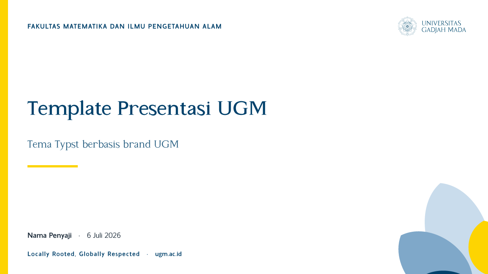
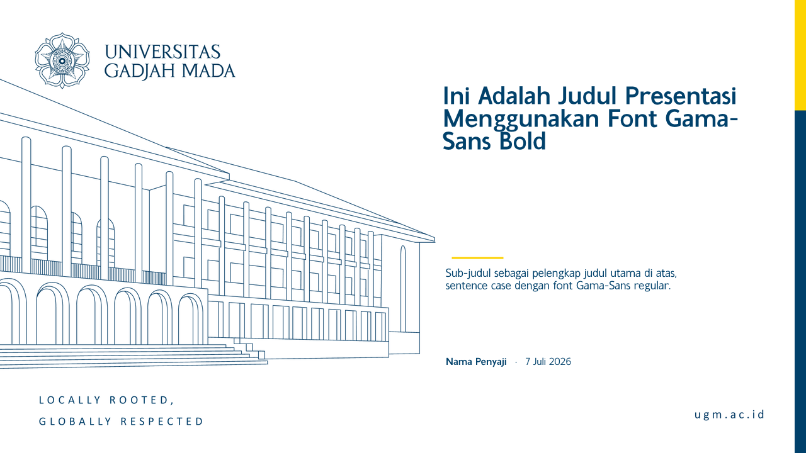

# ugm-slides

**Universitas Gadjah Mada** presentation themes for [Typst](https://typst.app),
brand-matched to the official UGM PowerPoint templates — navy `#01416B`, gold
`#FDD402`, the *Gama-Serif* / *Gama-Sans* typefaces, and the *Locally Rooted,
Globally Respected* footer.

The package ships **two themes** — pick one per deck:

| Theme | Import | Looks like | Best for |
|-------|--------|-----------|----------|
| **`ugm-theme`** (default) | `lib.typ` | Navy-forward, lotus-petal motif, a **top-right section-navigation bar** inspired by [`diatypst`](https://typst.app/universe/package/diatypst) | Lecture / teaching decks that benefit from persistent section navigation |
| **`ugm-clean-theme`** | `clean.typ` | Faithful to *"(NEW) Template Presentasi UGM 5.pptx"* — white canvas, the **Balairung UGM line-art**, gold+navy edge accents, and the template's **smaller type scale** (30pt titles, 14pt body) | Formal / institutional decks that must match the official PPTX exactly |

| `ugm-theme` (nav) | `ugm-clean-theme` (UGM-5) |
|---|---|
|  |  |

## Features

- 🎨 Brand-matched title, section-divider, and content slides.
- 🧭 Top-right navigation bar listing every `= Section`; the active one is a gold pill.
- ✍️ Write slides like Markdown: `= Section` → divider, `== Title` → content slide.
- 🅰️ Bundled UGM fonts (Gama-Sans / Gama-Serif) and logos.
- ⭐ Helpers: `focus-slide`, `columns-slide`, exposed `ugm-navy` / `ugm-gold`.

## Quick start

```typ
#import "lib.typ": *

#show: ugm-theme.with(
  title: "Judul Presentasi",
  subtitle: "Sub-judul opsional",
  author: "Nama Penyaji",
  faculty: "Fakultas MIPA",   // optional
  date: "6 Juli 2026",
  toc: true,                  // optional agenda slide
)

= Pendahuluan          // section divider + nav entry
== Latar Belakang      // content slide
- poin satu
- poin *dua*

#focus-slide[Kalimat penekanan]

= Penutup
== Terima Kasih
Kontak: nama\@ugm.ac.id
```

## Compiling

The UGM fonts are bundled in `assets/fonts`, so compile with `--font-path`:

```bash
typst compile --font-path assets/fonts example.typ
```

Live preview while editing:

```bash
typst watch --font-path assets/fonts example.typ
```

Without `--font-path` the deck still compiles but falls back to default fonts.

## `ugm-theme` parameters

| Parameter        | Default                              | Description                                   |
|------------------|--------------------------------------|-----------------------------------------------|
| `title`          | `none`                               | Title-slide heading (required for title slide)|
| `subtitle`       | `none`                               | Sub-heading on the title slide                |
| `author`         | `none`                               | Presenter name                                |
| `date`           | `none`                               | Presentation date                             |
| `faculty`        | `none`                               | Faculty / unit, shown above the title         |
| `ratio`          | `16/9`                               | Aspect ratio (use `4/3` for standard)         |
| `height`         | `7.5in`                              | Slide height (width = `ratio × height`); `7.5in` is the real PowerPoint 16:9 canvas |
| `footer-tagline` | `"Locally Rooted, Globally Respected"` | Footer tagline                              |
| `url`            | `"ugm.ac.id"`                        | Footer URL                                    |
| `toc`            | `false`                              | Render a "Daftar Isi" agenda slide            |
| `show-nav`       | `true`                               | Show the top-right section-navigation bar     |

## Authoring reference

| You write        | You get                                            |
|------------------|----------------------------------------------------|
| `= Section`      | Full-bleed navy **section divider** + a nav entry  |
| `== Title`       | A new **content slide** (auto page-break)          |
| `=== Subtitle`   | An in-slide sub-heading                             |
| `#focus-slide[…]`| Full-bleed navy emphasis slide                     |
| `#columns-slide(a, b, …)` | Equal-width multi-column layout           |

Standard Typst markup (lists, `+` enums, `*bold*`, `_italic_`, tables, `raw`
code, `#quote`, term lists `/ Term: desc`) is styled to the UGM palette.

## Theme B — `ugm-clean-theme` (follows *Template Presentasi UGM 5*)

A lighter, white-canvas theme that mirrors the official *UGM 5* PowerPoint,
including its smaller type scale. Chrome (logo, footer bar, and the Balairung
line-art) is baked into authentic backgrounds exported from the PPTX, so the
result is pixel-faithful.

```typ
#import "clean.typ": *

#show: ugm-clean-theme.with(
  title: "Judul Presentasi",
  subtitle: "Sub-judul opsional",
  author: "Nama Penyaji",
  date: "7 Juli 2026",
)

= Pendahuluan          // section divider (building line-art, big gold number)
== Latar Belakang      // content slide (white, logo + footer bar)
- poin *penting*

#quote-slide[
  "Kutipan penting dalam Gama-Sans light italic."
]
```

Compile it the same way: `typst compile --font-path assets/fonts example-clean.typ`.

| You write         | You get (theme B)                                          |
|-------------------|------------------------------------------------------------|
| `= Section`       | Divider: navy building line-art + big gold `01` + title    |
| `== Title`        | White content slide, gold-tick title, baked footer bar     |
| `=== Subtitle`    | In-slide sub-heading                                        |
| `#quote-slide[…]` | Quote/closing slide — light-italic quote beside the building|
| `#columns-slide(…)`| Equal-width multi-column layout                           |

**Type scale:** title 30pt · slide-title 22pt · body 18pt · sub-heading 19pt ·
quote 25.5pt · section number 52pt (title & subtitle match the PPTX; body is
enlarged from the PPTX's 14pt for on-screen readability). The canvas is the real
PowerPoint size (13.333in × 7.5in). To restore the PPTX's compact 14pt body,
change the base `set text(... size: 18pt)` in `clean.typ`.

**Note:** the footer tagline / `ugm.ac.id` and the logo are part of the baked
background images, so they are fixed (not parameters) in theme B.

## Assets & licensing

`assets/` contains UGM fonts and logos from the official brand kit. They are the
property of Universitas Gadjah Mada and are included here for producing UGM
presentations. The theme **code** in `lib.typ` is released under the MIT license.

## Files

```
ugm-slides/
├── lib.typ              # theme A (nav bar)
├── clean.typ            # theme B (UGM-5, smaller fonts)
├── example.typ          # demo deck for theme A
├── example-clean.typ    # demo deck for theme B
├── typst.toml           # package manifest
├── README.md
├── assets/
│   ├── fonts/           # Gama-Sans*, Gama-Serif*
│   ├── logos/           # UGM logo & emblem (navy / white)
│   └── backgrounds/     # theme B backgrounds (exported from the PPTX)
└── template/
    ├── main.typ         # starter deck (theme A)
    ├── thumbnail.png    # theme A
    └── thumbnail-clean.png  # theme B
```
